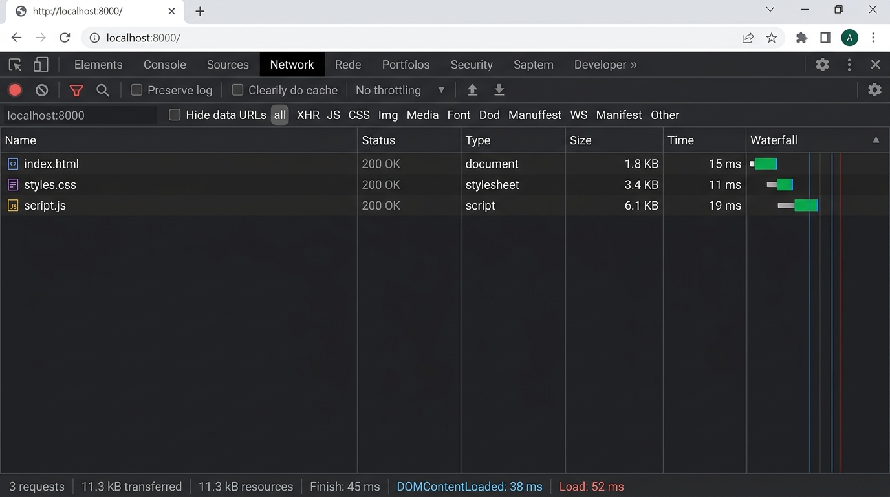

# TaskAlert - Organizador de Tarefas

> **Atividade:** Aplicação Web Mínima (Etapa 2 - O App)  
> **Disciplina:** Desenvolvimento de Sistemas Web (EECP0036) · Turma 24N12 · 2026.2  
> **Instituição:** Universidade Federal do Maranhão (UFMA) · Engenharia da Computação  
> **Professor:** Renan Sousa Freire  
> **Aluno:** Rhuã Yuri N. Sardinha  
> **Matrícula:** 20260060198  
> **Trilha:** C (Sem API externa · Lógica no cliente e dados persistidos no `localStorage`)

---

## 1. Descrição do App

O **TaskAlert** é uma aplicação web focada em produtividade e organização pessoal para estudantes e profissionais. O aplicativo permite cadastrar atividades diárias com categorias específicas (Estudos, Trabalho, Atividades Domésticas e Pessoal), definindo prazos e níveis de prioridade (Baixa, Média e Alta), com alertas visuais destacados para tarefas urgentes ou que estejam próximas do vencimento.

---

## 2. Funcionalidades

### O que o app faz:
- **Cadastro completo:** Cadastra tarefas informando nome, categoria, prazo limite e prioridade.
- **Validação de entradas:** Valida o preenchimento de todos os campos obrigatórios antes do cadastro, alertando o usuário sem quebrar o fluxo da aplicação.
- **Destaque e alertas visuais:** Identifica e destaca visualmente tarefas de alta prioridade e tarefas com prazos vencidos ou urgentes (que vencem no dia de hoje ou no dia seguinte).
- **Gestão de status:** Permite alternar o status de uma tarefa entre pendente e concluída (com efeito riscado e opacidade reduzida).
- **Remoção de tarefas:** Permite excluir tarefas individuais da lista.
- **Filtros dinâmicos:** Permite filtrar tarefas cadastradas por categoria e por status (todas, pendentes ou concluídas).
- **Persistência local:** Salva automaticamente o estado da lista no `localStorage` do navegador para manter os dados mesmo após recarregar ou fechar a página.

### O que o app não faz:
- Não possui cadastro de usuários ou autenticação/login.
- Não realiza sincronização remota na nuvem entre dispositivos diferentes.
- Não envia notificações nativas (push notifications) ou e-mails; todos os alertas são exibidos diretamente na interface da página.

---

## 3. Tecnologias Utilizadas

- **HTML5 Semântico:** Uso de tags apropriadas (`<header>`, `<main>`, `<section>`, `<form>`, `<label>` associados por `for`/`id`, `<ul>`, `<li>`, `<footer>`) e atributos de acessibilidade (`aria-live`, `role="alert"`, `aria-label`).
- **CSS3 Responsivo:** Layout adaptável para smartphones, tablets e desktops (Flexbox e CSS Grid), variáveis de design tokens, paleta de cores harmoniosa e estados interativos (`:focus-visible`, `:hover`). Sem uso de frameworks externos.
- **JavaScript Vanilla (ES6+):** Manipulação segura do DOM, cálculo dinâmico de datas para prazos e persistência estruturada no `localStorage`.

### Segurança Básica (Prevenção de XSS)
Conforme exigido pelas boas práticas da disciplina, **nenhum dado digitado pelo usuário é inserido na página utilizando `innerHTML`**. Todo o conteúdo textual é criado através da API de nós do DOM (`document.createElement`) e atribuído estritamente via **`textContent`**, garantindo proteção total contra injeção de scripts maliciosos (Cross-Site Scripting).

---

## 4. Como Executar o Projeto Localmente

Como o projeto é construído em tecnologias puras da Web (HTML, CSS e JavaScript), não é necessária a instalação de dependências ou gerenciadores de pacotes pesados.

### Opção 1: Servidor HTTP embutido do Python 3 (Recomendado)

1. Abra o terminal na pasta raiz do projeto.
2. Execute o comando:
   ```bash
   python3 -m http.server 8000
   ```
3. Abra seu navegador e acesse:
   ```
   http://localhost:8000
   ```

### Opção 2: Extensão Live Server (VS Code)

1. Abra o diretório do projeto no Visual Studio Code.
2. Clique com o botão direito sobre o arquivo `index.html` e selecione **"Open with Live Server"**.

---

## 5. Inspeção da Aba Rede (Network)

Abaixo está o registro da requisição do carregamento da aplicação inspecionada pela ferramenta de desenvolvedor do navegador (F12 > Aba Rede / Network):



### Explicação da Aba Rede (2 a 3 linhas):
> A captura da aba Rede (*Network*) demonstra o carregamento dos recursos essenciais da aplicação através do servidor local HTTP. Observa-se a requisição principal do documento `index.html` via método **GET** retornando status **200 OK**, seguida imediatamente pelo download do arquivo de estilos `styles.css` e do script de comportamento `script.js` (ambos com status **200 OK**), confirmando a entrega correta e íntegra de todos os ativos estáticos no navegador.

---

## 6. Declaração do Uso de Inteligência Artificial

Em conformidade com a seção 8 da especificação da disciplina DSW:

- **Ferramenta utilizada:** Antigravity (Google DeepMind).
- **O que foi solicitado:** Apoio na estruturação semântica do HTML5, na criação dos estilos CSS responsivos com tokens e variáveis, e no aprimoramento da lógica JavaScript para persistência no `localStorage` e cálculo de urgência de prazos.
- **O que foi alterado/revisado:** O código gerado foi minuciosamente revisado e ajustado para atender estritamente aos requisitos do modelo de proposta da Etapa 1 submetido pelo aluno Rhuã Yuri N. Sardinha, garantindo a validação de campos vazios, a ausência total de `innerHTML` para inserção de dados do usuário (usando exclusivamente `textContent`) e a independência de frameworks externos.
